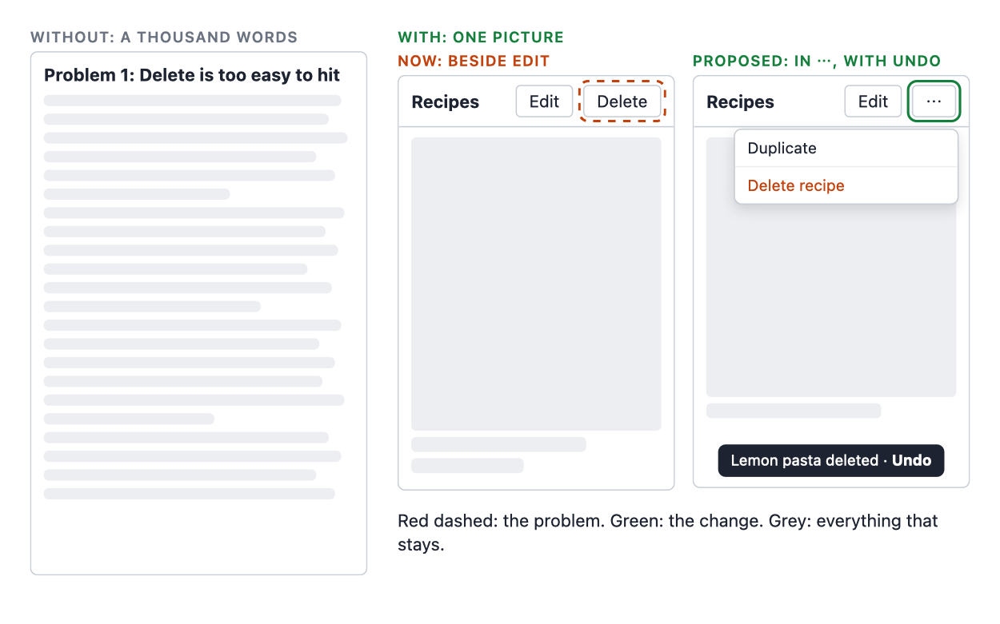
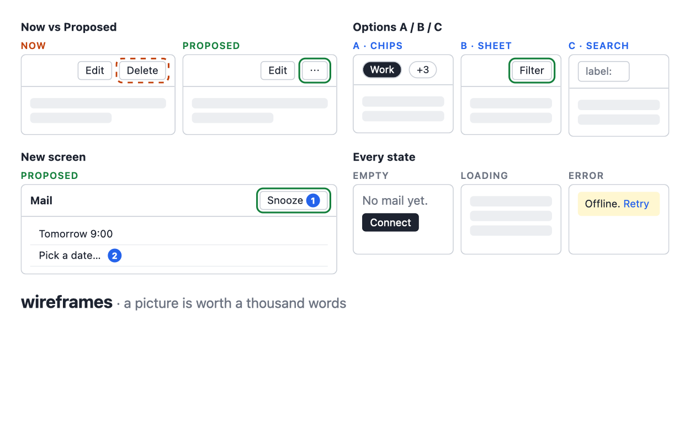
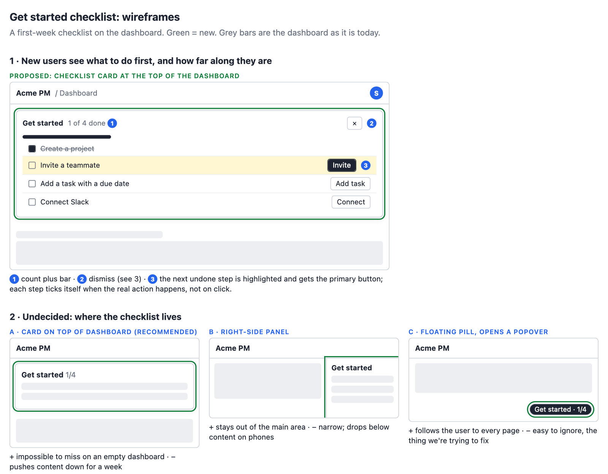

# wireframes

An agent skill for proposing UI changes as pictures, not prose.



**The principle: a picture is worth a thousand words.** When an agent proposes a UI change,
you shouldn't have to read three paragraphs to picture it. This skill makes the agent draw
each change as a cheap wireframe instead. It puts **Now** (red, dashed outline on the
problem) next to **Proposed** (green, solid outline on the change), uses grey bars for
everything that stays the same, and adds one sentence on why.

It deliberately doesn't copy your app's real look. A page of five proposals is 10-15 KB of
HTML, so it's quick to draw, quick to read and quick to change.

| Layout | Use it when |
|---|---|
| Now vs Proposed | something exists and should change |
| Options A / B / C | the fix isn't decided; each option shows its gain and cost |
| New screen | nothing exists yet; numbered callouts explain the parts |
| States strip | one element across empty, loading, error or phone width |



### What you get

The agent saved this page from a short request for a first-week "Get started" checklist on a
project-management app's dashboard. The new card comes with
numbered notes, and placement is offered as options A/B/C with a recommendation. The page is
about 9 KB of HTML.



It triggers when an agent proposes UI changes for you to decide on. That includes after a
design critique or UX audit, while brainstorming a screen, and when you ask what something
would look like. It stays out of the way for colour or font tweaks and for changes you've
already decided on.

## Install

It's a standard [Agent Skill](https://agentskills.io): one folder, `skills/wireframes/`, with a
`SKILL.md` and a `kit.html`. The repo is also a plugin for the agents that have plugin
systems, so most agents can install it with one command.

| Agent | Install | Tested |
|---|---|---|
| Claude Code | `/plugin marketplace add falconair/wireframes`<br>`/plugin install wireframes@wireframes` | ✓ |
| Gemini CLI | `gemini skills install https://github.com/falconair/wireframes.git --path skills/wireframes` | ✓ |
| GitHub Copilot CLI | `copilot plugin install falconair/wireframes` | |
| VS Code (Copilot) | Command Palette → **Chat: Install Plugin from Source** → `https://github.com/falconair/wireframes` | |
| Codex | `codex plugin marketplace add falconair/wireframes`, then install **wireframes** from `/plugins` | |
| Cursor | **Customize** → **From GitHub Repository** → `https://github.com/falconair/wireframes` | |
| Antigravity CLI | `agy plugin install https://github.com/falconair/wireframes` | |

The untested rows follow each agent's documentation as of November 2026. If one doesn't
work for you, please [open an issue](https://github.com/falconair/wireframes/issues).

### Any agent that reads skills

These installers put the skill wherever your agent looks for it:

```bash
gh skill install falconair/wireframes wireframes --agent <agent> --scope user   # GitHub CLI 2.90+
npx skills add falconair/wireframes -g                                          # vercel-labs/skills
```

Or copy it by hand. Codex, Gemini CLI, Copilot, Cursor and OpenCode all read
`~/.agents/skills/`:

```bash
git clone https://github.com/falconair/wireframes /tmp/wireframes
mkdir -p ~/.agents/skills && cp -R /tmp/wireframes/skills/wireframes ~/.agents/skills/
```

If your agent doesn't support skills at all, paste `SKILL.md` into its instructions and keep
`kit.html` next to it. The skill only needs to read `kit.html` and write one HTML file.

## Where the pictures go

Mockups are saved in your project at `docs/mockups/YYYY-MM-DD-<topic>.html`, or in the
project's existing `mockups/` folder if it has one, so they can be committed alongside the
code. If the agent has a browser tool that can take screenshots, it looks at the page before
showing it to you. Without one, it tells you it hasn't seen the page. It doesn't depend on any
other skill or plugin.

## What's in the repo

- `skills/wireframes/SKILL.md`: what to draw, the size budget, how to check the page, and
  how to hand it over.
- `skills/wireframes/kit.html`: about 4 KB of fixed CSS that gets copied verbatim, plus
  one worked example of each layout.
- `evals/`: a `claude plugin eval` suite (Claude Code) with
  four layout cases and two cases where the skill shouldn't fire:
  `claude plugin eval . --allow-tools Write Edit Bash --scaffold --no-publish`.
- `evals-trigger/`: 20 short prompts (10 that should fire the skill, 10 near misses) that
  check only whether it fires:
  `claude plugin eval . --eval-dir evals-trigger --ablation none --no-publish`.
- `PUBLISHING.md`: for the maintainer, how to release a new version and where the skill
  is listed.
- `tests/recipe-box/`: the first hand-run test, with the critique it was given and the
  outputs with and without the skill.

## Licence

MIT
